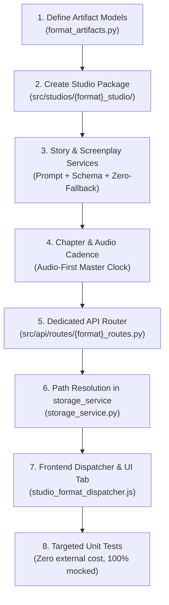

# CineAI Studio Format Pipeline Blueprint & Engineering Template

> **Authoritative Specification:** This document is the master engineering blueprint and template for all media production formats across CineAI Studio (e.g. `relaxation`, `documentary`, `walking_tour`, `concert`, `travel_guide`). When creating any new studio format, follow this specification verbatim to ensure end-to-end parity with the established relaxation and documentary engines.

---

## 1. Directory & Storage Architecture

All media productions are scoped hierarchically under user network storage to guarantee tenant isolation, multi-channel management, and clean asset tracking:

```text
storage/
  └── {user_container}/                      # e.g., user-knpillutla-gmail-com
      └── networks/
          └── {channel_id}/                  # e.g., euro_discovery, earth_serenade
              └── {format_slug}/             # e.g., documentary, relaxation, walking_tour
                  └── {entity_slug}/         # e.g., slovenia, norway, alps (destination / production name)
                      └── {episode_id}/      # e.g., ep-001, ep-002 (lowercase standard)
```

### Path Resolution Rules
1. **Format Decoupling:** Every format MUST use its own slug in the directory path (`/documentary/`, `/relaxation/`, etc.).
2. **Entity Grouping:** Geo-specific or subject-specific productions MUST be stored in their respective destination entity subfolder (e.g. `/slovenia/ep-001/`), resolved automatically from user prompt, country dropdown, or Gemini story output.
3. **No Root Littering:** Scratch scripts, intermediate concat files, and audio parts must remain strictly within the episode directory.

---

## 2. Complete Artifact Matrix (14 Mandatory Output Artifacts)

Every format pipeline MUST produce the following standardized artifacts. All JSON artifacts are stored formatted (`indent=2`) with UTF-8 encoding for real-time inspection in the UI Artifact Inspector.

| # | Artifact Filename | Type | Generated By | Purpose & Content Description |
|---|---|---|---|---|
| **1** | `user_inputs.json` | JSON | Frontend / Router | Complete record of user configuration: prompt, channel, genre, sub-genre, archetype, weather, duration, shots, tier, image/motion models, and execution mode (`prod` vs `test`). Used for exact idempotent re-runs. |
| **2** | `gemini_story_inputs.json` | JSON | Story Service | Exact parameters, system instructions, and user prompt dispatched to Gemini for story generation (for reproducibility and debugging). |
| **3** | `gemini_inputs.json` | JSON | Story Service | Backward-compatible alias/mirror of Gemini story inputs. |
| **4** | `raw_gemini_story.json` | JSON | Story Service (Gemini) | Sovereign multi-chapter narrative structure (e.g. 21 chapters for documentary) containing chapter titles, subtitles, statistical facts, badge data, and voiceover text. |
| **5** | `narration_stems/chapter_{i}_padded.mp3` | Audio Stem | Audio / TTS Service | Individual 48kHz 24-bit stereo chapter narration stems with deterministic head delay (0.8s) and tail breathing padding (2.5s). |
| **6** | `spoken_narration.mp3` | Master Audio | FFmpeg Concat | Master continuous voiceover track concatenated from all chapter narration stems. Acts as the master timeline clock. |
| **7** | `gemini_screenplay_inputs.json` | JSON | Screenplay Engine | Exact directorial parameters, scene counts, duration targets, and prompt dispatched to Gemini Director for visual scene formulation. |
| **8** | `raw_gemini_screenplay.json` | JSON | Screenplay Engine (Gemini) | Directorial screenplay containing shot-by-shot visual prompts, camera motion types, lighting, and cinematic movement configs. |
| **9** | `screenplay.json` | JSON | Screenplay Engine | Standardized runtime screenplay matching `RelaxScreenplay` / `DocStoryboard` contract for timeline execution. |
| **10** | `keyframe_p1.jpg` ... `keyframe_pN.jpg` | 4K Photos | Visual Batch Engine | 4K 16:9 master keyframes generated via diffusion models (Flux 1.1 Pro Ultra, Z-Image Turbo, Google Imagen3). |
| **11** | `raw_soundtrack.mp3` & `velvet_binaural_master_48k.mp3` | Master BGM | Soundtrack & Binaural DSP | Procedural/AI musical soundtrack normalized to -14 LUFS with 432Hz velvet acoustic mastering and 48kHz broadcast audio. |
| **12** | `motion_p1.mp4` ... `motion_pN.mp4` | 4K Video Clips | Motion Diffusion Engine | Individual 4K 24fps/30fps video motion clips rendered via Kling v3, Wan 2.1, or local 4K camera drone engine. |
| **13** | `master_4k_narration.mp4` / `master_4k_documentary.mp4` | 4K Master Video | Single-Pass FFmpeg | Broadcast-grade 4K master video with audio ducking (-18dB under speech), synchronized scene transitions, and timed subtitles. |
| **14** | `short_9x16_teaser.mp4` | 9:16 Short Video | Smart Reframe FFmpeg | Vertical teaser optimized for YouTube Shorts, Instagram Reels, and TikTok with center-weighted or motion-tracked crop. |
| **15** | `youtube_packaging.json` | Metadata JSON | Metadata Packaging Service | Full YouTube publishing package: high-CTR title, SEO description, chapter timestamps, tags, and synthetic media disclosure. |
| **16** | `youtube_packaging_short.json` / `youtube_packaging_nature_only.json` | Metadata JSON | Metadata Packaging Service | Dedicated metadata packaging for vertical shorts or ambient pure-nature editions. |
| **17** | `episode_manifest.json` & `pipeline_state.json` | State JSON | Pipeline Orchestrator | High-level episode metadata, stage completion flags, and real-time execution state for UI progress trackers. |

---

## 3. Strict Idempotency Contract ("Only Synthesize What is Missing")

All pipeline stages must be **100% idempotent**. When a user clicks a manual step (e.g. "Generate Audio", "Generate Keyframes") or clicks "Re-Synthesize", the system MUST NOT re-invoke external APIs or re-render files that already exist.

### Idempotency Check Rules

```python
def should_generate_artifact(file_path: Path, force_rerun: bool = False) -> bool:
    """Universal Tier 1 disk check rule across all formats."""
    if force_rerun:
        return True
    # Artifact is valid if it exists on disk and is not an empty/corrupted stub
    return not (file_path.is_file() and file_path.stat().st_size > 1000)
```

### Stage-by-Stage Idempotency Behavior

1. **Stage 1: Story Formulation (`raw_gemini_story.json`)**
   - If `raw_gemini_story.json` exists (>1KB) and not `force_rerun`: Load existing story from disk. Skip Gemini call ($0.00 spend).
   - If missing: Dispatch prompt to Gemini, validate structured schema, and persist `raw_gemini_story.json`, `gemini_story_inputs.json`, and `user_inputs.json`.

2. **Stage 2: Narration Voiceover (`narration_stems/` & `spoken_narration.mp3`)**
   - Check each `chapter_{i}_raw.mp3`: If present, skip TTS synthesis.
   - Check each `chapter_{i}_padded.mp3`: If present, skip FFmpeg padding.
   - Check `spoken_narration.mp3`: If present, skip FFmpeg concatenation.
   - Always probe media duration from disk to update timeline clocks accurately.

3. **Stage 3: Directorial Screenplay (`raw_gemini_screenplay.json`)**
   - If `raw_gemini_screenplay.json` exists (>1KB) and not `force_rerun`: Load existing screenplay. Skip Gemini call.
   - If missing: Dispatch to Director model, record `gemini_screenplay_inputs.json`, and persist `raw_gemini_screenplay.json`.

4. **Stage 4: 4K Keyframe Photos (`keyframe_p{i}.jpg`)**
   - Granular per-shot check: If `keyframe_p1.jpg` exists, do NOT regenerate it.
   - Batch engine only synthesizes missing shot indices (e.g., if shot 3 failed or user requested a single-shot regenerate).

5. **Stage 5: Soundtrack & Spatial BGM (`raw_soundtrack.mp3` & `velvet_binaural_master_48k.mp3`)**
   - If `raw_soundtrack.mp3` exists (>1KB), skip Suno synthesis.
   - If `velvet_binaural_master_48k.mp3` exists (>1KB), skip DSP mastering.

6. **Stage 6: Motion Video Clips (`motion_p{i}.mp4`)**
   - Granular per-clip check: Iterate `idx` from 1 to `num_scenes`.
   - If `motion_p{idx}.mp4` exists, verify duration matches audio cadence. If valid, skip rendering.
   - Only missing clips are queued for diffusion or local camera rendering.

7. **Stage 7: 4K Master Render (`master_4k_narration.mp4`)**
   - If output master video exists, has valid filesize, and newer modification timestamp than its inputs, skip FFmpeg assembly.

8. **Stage 8: 9:16 Short & Metadata (`short_9x16_teaser.mp4` & `youtube_packaging.json`)**
   - If short video exists, skip cropping.
   - If `youtube_packaging.json` exists, reuse existing metadata.

---

## 4. Zero-Fallback Fail-Fast Policy

To guarantee cinema-grade quality and immediate root-cause transparency, live production runs (`execution_mode="prod"`) must **NEVER silently fall back** to dummy/canned templates.

### Non-Negotiable Error Directives
1. **No Silent Swallows:** Never catch an exception and return a hardcoded 3-scene mock in production.
2. **Immediate Loud Failure:** If an API key is missing, network fails, or model returns invalid JSON, raise a descriptive `RuntimeError` immediately:
   ```python
   if not api_key:
       raise RuntimeError("CRITICAL: GEMINI_API_KEY environment variable is missing or empty.")
   ```
3. **Mock Mode Isolation:** Deterministic offline fallbacks are permitted **ONLY** when `is_mock_mode() is True` (e.g. during automated local pytest runs).
4. **Schema Validation:** Incomplete stories (e.g., fewer chapters than requested) must fail fast rather than producing broken video files downstream.

---

## 5. UI Artifact Inspector Integration

The frontend Inspector displays real-time tabs for full transparency and debugging. All studio endpoints (`/api/{format}/poll-artifacts` or `/api/local-production/poll-artifacts`) must return:

```json
{
  "production_name": "slovenia",
  "user_inputs": { ... },
  "gemini_story_inputs": { ... },
  "gemini_screenplay_inputs": { ... },
  "gemini_inputs": { ... },
  "raw_story": { ... },
  "screenplay": { ... },
  "keyframes": [ ... ],
  "video_clips": [ ... ],
  "master_video": "/storage/.../master_4k_narration.mp4",
  "short_video": "/storage/.../short_9x16_teaser.mp4",
  "youtube_packaging": { ... }
}
```

The UI automatically binds these JSON payloads into interactive tabs:
- **User Inputs Tab:** Shows all original user options and re-run parameters.
- **Story Prompt Tab:** Shows Gemini story prompt, system instruction, and model.
- **Story Output Tab:** Shows 21-chapter raw JSON with facts and stats.
- **Screenplay Inputs Tab:** Shows Gemini screenplay directorial prompt.
- **Screenplay Output Tab:** Shows visual prompts, camera angles, and durations.

---

## 6. Developer Implementation Checklist for New Formats

When implementing a new format (e.g. `podcast_studio`, `concert_studio`, `walking_tour_studio`), follow these steps in order:



### Detailed Step Guide

1. **Step 1: Domain Artifact Model**
   - Add `{Format}Artifacts` to `src/domain/format_artifacts.py` including `user_inputs`, `gemini_story_inputs`, `gemini_screenplay_inputs`, `raw_story`, and media lists.

2. **Step 2: Studio Package Structure**
   - Create `src/studios/{format}_studio/`:
     - `{format}_story_service.py`: Gemini prompt formulation and raw story generation.
     - `{format}_screenplay_engine.py`: Directorial screenplay formulation with visual prompts.
     - `{format}_audio_service.py`: TTS / BGM / stems with audio padding.
     - `{format}_export_service.py`: Master assembly and YouTube packaging.
   - Enforce Rule 4: Target 120–220 lines per file; never exceed 300 lines.

3. **Step 3: Dedicated API Router**
   - Create `src/api/routes/{format}_routes.py` with prefix `/api/{format}`:
     - `POST /create-episode`: Reserves episode ID, writes `user_inputs.json` and `episode_manifest.json`.
     - `POST /produce`: Executes pipeline stages independently (`script_only`, `photos_only`, `motion_only`, `audio_only`, `master_only`).
     - `GET /artifacts/{channel_id}/{episode_id}`: Scans and returns full artifact model.

4. **Step 4: Path Resolution**
   - Ensure `storage_service.get_channel_format_production_episode_path(...)` and `find_episode_path(...)` support the new format slug.

5. **Step 5: Frontend Dispatcher**
   - In `src/static/js/format_renderers/studio_format_dispatcher.js`, map format slug to dedicated story and episode creators.
   - In `prompt_generator.js`, wire archetype and dropdown selection changes.

6. **Step 6: Idempotency Enforcement**
   - Add Tier 1 file checks for all 14 artifacts.
   - Ensure `--id <episode_id>` re-uses existing assets without duplicate API spend.

7. **Step 7: Verification via Targeted Unit Tests**
   - Create `tests/test_{format}_pipeline_and_artifacts.py`.
   - Verify folder creation, input file persistence, artifact scanner discovery, and zero-spend idempotency using local test fixtures.
   - **Never call live models in automated tests.**

---
*CineAI Studio Engineering Architecture — Confidential & Proprietary*
